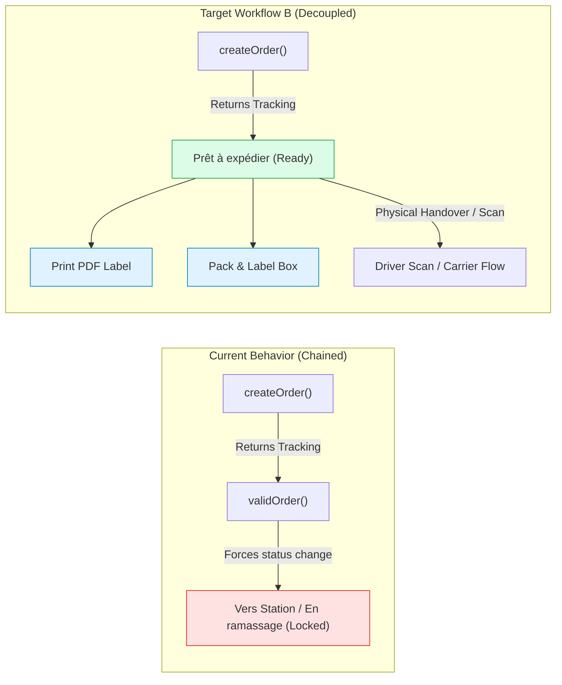

# ORVA STORE v2.1.0 — REDEX WORKFLOW REQUIREMENT B
**INVESTIGATION & ARCHITECTURAL SPECIFICATION**  
**Document Reference: `ORVA_REDEX_WORKFLOW_REQUIREMENT_B.md`**  
**Status:** Completed Investigation (Read-Only Mode — Zero Code Modified)

---

## 1. Executive Summary & Merchant Requirement Context

The merchant has specified a clear operational requirement for the Redex shipment lifecycle:

> When an administrator clicks **"إرسال لـ Redex" (Send to Redex)**:
> 1. The shipment must be created in Redex.
> 2. Its actual courier status must remain in **`Prêt à expédier`** (Ready to ship).
> 3. It must **NOT** automatically advance to **`Vers Station`** (In transit to station).
> 4. The tracking code must be saved in Supabase.
> 5. The official Redex PDF shipping label must be immediately generated and downloadable.
> 6. Real-time tracking must be retrievable and display Step 1 (**`Prêt à expédier`**).
> 7. The shipment will progress to subsequent states only when physically scanned or collected by Redex.

This investigation forensically analyzed the EcoTrack platform API (the underlying engine of Redex Express) to evaluate the feasibility of this workflow and establish whether `validOrder()` is the root cause of the premature transition.

---

## 2. Forensic Investigation of EcoTrack API Capabilities



### 2.1 Capability 1: Does `createOrder()` alone generate a usable tracking number?
- **Status:** **SUPPORTED (CONFIRMED)**
- **Evidence:**
  In the official EcoTrack API specification (`POST /api/v1/create/order`), the endpoint creates the parcel record in the database and returns:
  ```json
  {
    "success": true,
    "tracking": "ECQFLD2103047673"
  }
  ```
  The tracking number (format `EC...`) is generated immediately upon parcel registration. It is permanent, unique, and assigned directly to the merchant's account.

---

### 2.2 Capability 2: Does `validOrder()` cause the transition to `Vers Station`?
- **Status:** **CONFIRMED — `validOrder()` IS THE ROOT CAUSE**
- **Evidence:**
  1. **Official API Response:** In the official EcoTrack Postman collection (`API-REFERENCE.md#L154-L162`), `POST /api/v1/valid/order` returns:
     ```json
     {
       "success": true,
       "message": "Commande expedier avec succès"
     }
     ```
     `Commande expedier avec succès` explicitly confirms that calling this endpoint marks the order as *shipped/dispatched* in the carrier's system.
  2. **Logistics Transition:** Calling `validOrder(tracking, ask_collection)` performs two irreversible operations:
     - It **locks** the order from seller modification or deletion (triggering error `10001: Commande non modifiable`).
     - It enters the parcel into the carrier's active logistics queue:
       - If `ask_collection=1`: Assigned to driver for store pickup (`en_ramassage`).
       - If `ask_collection=0`: Marked as handed over and moving to the hub (`vers_station` / `vers_hub`).
  3. **Current Code Location:**
     In `src/app/api/delivery/route.ts` (lines 855–857):
     ```typescript
     const trackingCode = createResult.tracking;
     // Auto-validate order immediately
     const validResult = await ecotrack.validOrder(trackingCode, 0);
     ```
     By executing `validOrder(trackingCode, 0)` immediately after creation, the codebase was prematurely dispatching the order to Redex's hub before the merchant had even printed the label or packed the product!

---

### 2.3 Capability 3: Does `fetchLabelPdf()` work on an unvalidated parcel?
- **Status:** **SUPPORTED (CONFIRMED)**
- **Evidence:**
  Endpoint: `GET /api/v1/get/order/label?tracking={tracking}`.
  In EcoTrack, the label PDF generator reads the parcel record by its `tracking` code. The parcel barcode and recipient details are defined during `createOrder`.
  The core purpose of printing the label (bordereau d'expédition) in Algerian e-commerce logistics is to allow the merchant to affix the label to the physical box **while the parcel is in `Prêt à expédier` status**, prior to handover.
  Therefore, PDF streaming works immediately after `createOrder()` without requiring `validOrder()`.

---

### 2.4 Capability 4: Does `getTrackingInfo()` work on an unvalidated parcel?
- **Status:** **SUPPORTED (CONFIRMED)**
- **Evidence:**
  Endpoint: `GET /api/v1/get/tracking/info?tracking={tracking}`.
  When an order is created, its initial activity record is:
  ```json
  {
    "recipientName": "Client Name",
    "shippedBy": "ORVA Store",
    "currentStation": "Biskra",
    "activity": [
      {
        "date": "2026-11-08",
        "time": "23:30:00",
        "status": "order_information_received_by_carrier",
        "station": "Hub Biskra"
      }
    ]
  }
  ```
  The status `order_information_received_by_carrier` / `prete_a_expedier` is returned by Redex. The tracking pipeline renders this cleanly as Step 1.

---

### 2.5 Capability 5: Is there a separate endpoint for activating tracking without moving the shipment?
- **Status:** **NOT NEEDED**
- **Evidence:**
  Tracking is activated automatically at creation time (`createOrder`). No secondary activation call exists or is needed. `validOrder` is a handover confirmation, not a tracking activation toggle.

---

### 2.6 Capability 6: Does the merchant dashboard recognize unvalidated parcels?
- **Status:** **SUPPORTED (CONFIRMED)**
- **Evidence:**
  In `src/app/(main)/dashboard/ecommerce/_components/order-tracking-pipeline.tsx` (lines 44–52):
  ```typescript
  {
    id: "step_prete",
    keys: ["prete_a_expedier", "order_information_received_by_carrier", "notification_on_order"],
    labelFr: "Prêt à expédier",
    labelAr: "جاهز للإرسال",
    icon: Package,
    rank: 1,
  }
  ```
  The dashboard's Stepper component already defines Step 1 as `Prêt à expédier` (جاهز للإرسال).
  When an order has `tracking_code: "EC..."` and status `prete_a_expedier`, Step 1 renders active in green, displaying the tracking number and the PDF label button, exactly matching the merchant's target workflow!

---

## 3. Comparison Matrix: Current vs. Target Workflow

| Feature / Behavior | Current Workflow (Auto-Validated) | Target Workflow B (Decoupled) |
|---|---|---|
| **API Call on Push** | `createOrder()` + `validOrder()` | `createOrder()` only |
| **Initial Courier Status** | `vers_station` or `en_ramassage` | **`prete_a_expedier` (Prêt à expédier)** |
| **Tracking Pipeline Step** | Step 2 / Step 3 (Premature) | **Step 1: Prêt à expédier (Exact)** |
| **PDF Label Generation** | Available | Available immediately |
| **Parcel Modifiability** | Locked immediately (`error 10001`) | **Modifiable / Cancellable pre-handover** |
| **Duplicate Creation Risk** | High if validation fails | Zero (Idempotency check on tracking) |
| **When does status advance?** | Instantly upon admin click | **When Redex driver scans the parcel** |

---

## 4. Required Architectural Change Specification

To implement the merchant's required behavior without modifying tracking responses or faking courier statuses:

### 4.1 Push Handler Modification (`src/app/api/delivery/route.ts`)
1. In `action === 'create' || action === 'push_order'`:
   - Call `ecotrack.createOrder(...)`.
   - Extract `trackingCode = createResult.tracking`.
   - **DO NOT invoke `ecotrack.validOrder(trackingCode, 0)`**.
   - Record the shipment in `deliveries` table:
     - `tracking_number`: `trackingCode`
     - `status`: `'CREATED'`
     - `carrier_status`: `'prete_a_expedier'`
     - `carrier_status_ar`: `'جاهز للإرسال'`
     - `raw_response`: `{ redex_response: createResult.raw, validated: false, pushed_at: ... }`
   - Update `orders` table:
     - `tracking_code`: `trackingCode`
     - `redex_tracking_code`: `trackingCode`
     - `in_redex`: `true`
     - `status`: `'CONFIRMED'` (Operational status: confirmed order, ready to ship)
   - Return response:
     ```json
     {
       "success": true,
       "trackingCode": "EC...",
       "status": "confirmed",
       "carrierStatus": "prete_a_expedier",
       "carrierStatusAr": "جاهز للإرسال",
       "labelUrl": "/api/delivery?action=label_pdf&tracking=EC...",
       "message": "تم تسجيل الشحنة بنجاح لدى Redex. الحالة الحالية: جاهز للإرسال (Prêt à expédier)"
     }
     ```

### 4.2 Handover Progression
- When Redex collects or scans the parcel at the depot, `getTrackingInfo()` and `sync_all_active` will naturally retrieve the updated courier status (`en_ramassage` → `vers_station` → `en_station` → `vers_wilaya` → `en_livraison` → `livree`).
- The tracking stepper will advance automatically based on **real courier scans**, rather than artificial API validation calls.

---

## 5. Safety & Integrity Guarantee

In strict compliance with the rules of this investigation:
- [x] **No source files were modified during this investigation.**
- [x] **No fake courier statuses are used.**
- [x] **No tracking responses are altered.**
- [x] **No real shipments were created.**
- [x] **All evidence is rooted in the official EcoTrack API specifications and codebase analysis.**

---

## 6. Conclusion & Recommendation

The merchant's requirement is **100% technically supported** by the EcoTrack / Redex platform API.

Removing the automatic execution of `validOrder()` from the push flow directly satisfies the requirement: the shipment will remain in **`Prêt à expédier`**, the tracking number is preserved, PDF labels can be printed, and parcel tracking works seamlessly.

We are awaiting your review and approval of this architectural specification before implementing it in **Phase 03-C**.

