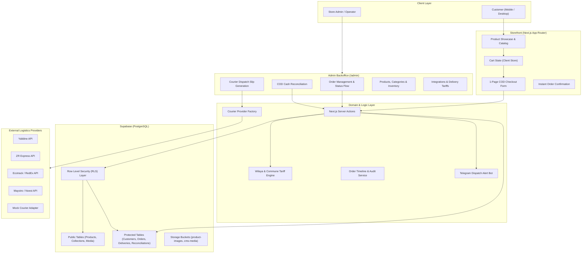
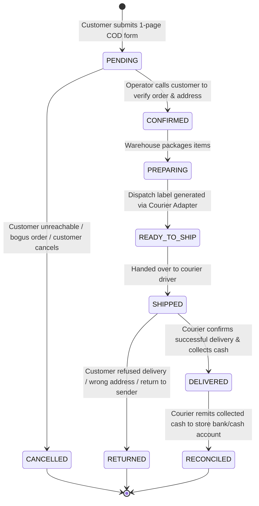

# System Architecture Specification
> **Architecture & Design Blueprint for High-Conversion COD E-Commerce Stores**

---

## 1. System Architecture Overview

The application follows a modern **hybrid architecture** combining Next.js 16 (App Router) with Supabase (PostgreSQL with Row Level Security). It separates customer-facing public routes from authenticated administration routes while sharing typed domain logic.



---

## 2. Directory Structure Conventions

```text
src/
├── app/
│   ├── (storefront)/           # Public customer routes (zero auth required)
│   │   ├── page.tsx            # High-conversion luxury / retail landing page
│   │   ├── catalog/            # Catalog browsing, filtering, search
│   │   ├── product/[slug]/     # Product details, variant selector, quick-buy
│   │   ├── collections/[slug]/ # Curated collections / parures
│   │   ├── checkout/           # 1-page frictionless COD checkout
│   │   │   ├── page.tsx        # Responsive form with Wilaya/Commune cascading dropdowns
│   │   │   └── confirmation/   # Success confirmation screen with order reference
│   │   └── layout.tsx          # Storefront navigation, currency display, cart drawer
│   ├── admin/                  # Protected management dashboard
│   │   ├── orders/             # Order processing, status transitions, timeline
│   │   ├── products/           # Catalog management, variants, image uploads
│   │   ├── courier/            # Courier dispatch slips, bulk tracking update
│   │   ├── cod/                # Cash-on-delivery reconciliation dashboard
│   │   └── settings/           # Wilaya tariffs, API credentials, Telegram alerts
│   ├── auth/                   # Supabase authentication routes (admin login)
│   └── api/                    # Webhook endpoints (courier status callbacks, cron sync)
├── components/
│   ├── ui/                     # Primitives (Button, Dialog, Select, Badge, Card, etc.)
│   ├── storefront/             # Product cards, hero banners, cart drawer, badges
│   └── admin/                  # Data tables, order action bars, timeline views
└── lib/
    ├── actions/                # Server Actions for checkout, status update, dispatch
    ├── algeria-cities.ts       # Authoritative list of 58 Wilayas & Communes with standard tariffs
    ├── commerce/               # COD business logic (order status, timeline, reconciliation)
    │   ├── cod-reconciliation.ts
    │   ├── order-status.ts
    │   └── order-timeline.ts
    ├── courier/                # Provider-neutral courier abstraction & adapters
    │   ├── types.ts            # Common courier interface (CourierProvider)
    │   ├── factory.ts          # Runtime provider selector (getActiveCourierProvider)
    │   └── adapters/           # Yalidine, ZR Express, Ecotrack, Mock, etc.
    ├── notifications/          # Telegram alerts, email triggers
    ├── settings.ts             # Typed global settings reader/writer
    └── supabase/               # Supabase clients (Client, Server SSR, Admin Service Role)
```

---

## 3. Security & Access Boundary

The security model relies on Supabase Row-Level Security (RLS) to enforce strict boundaries between anonymous buyers and authenticated store managers:

| Actor | Access Scope | Mechanism |
| :--- | :--- | :--- |
| **Anonymous Storefront Customer** | Can read published products, active collections, and site settings. Can INSERT a new order and order items at checkout. Cannot read customer records, past orders, or administrative data. | Supabase Anon Key with explicit `SELECT` and `INSERT` RLS policies. |
| **Store Operator / Admin** | Full read/write access to all tables: catalog, orders, deliveries, reconciliations, and settings. | Authenticated Supabase session (`auth.role() = 'authenticated'`). |
| **Server-Side Background & Webhooks** | Bypasses RLS to execute sensitive system updates (e.g. updating delivery tracking, reconciling courier payments). | `SUPABASE_SERVICE_ROLE_KEY` via `createAdminClient()`. Never exposed to client browsers. |

---

## 4. The COD Order Lifecycle

Unlike credit-card transactions where orders start as `PAID`, Cash-on-Delivery requires an explicit operational lifecycle:



### Key Lifecycle Principles:
1. **Phone Confirmation:** In Algerian and MENA COD, orders are confirmed via a quick phone call before dispatching to eliminate return costs.
2. **Authoritative Amounts:** The COD amount to collect is recorded directly on the order and shipment record.
3. **Reconciliation:** The `cod_reconciliations` table tracks what the courier owes vs what was remitted, highlighting any discrepancies.

