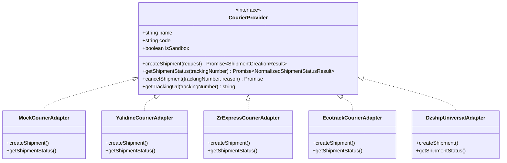

# Provider-Neutral Courier Integration Guide
> **Multi-Carrier Architecture for Algerian & MENA Cash-on-Delivery Logistics**

---

## 1. Architectural Philosophy

Logistics in Cash-on-Delivery markets is carrier-dependent, fragmented, and prone to API variations. To safeguard the core e-commerce engine against carrier changes, this template uses the **Adapter Design Pattern**.

Your business logic interacts *exclusively* with the `CourierProvider` contract. The individual courier adapters handle HTTP authentication, payload serialization, tracking URLs, and status normalization.



---

## 2. Core Interface Contract

Every courier adapter implements this TypeScript interface:

```typescript
export interface ShipmentCreationRequest {
  orderId: string;
  orderNumber: string;
  customer: {
    fullName: string;
    phone: string;
    additionalPhone?: string;
    wilaya: string;  // e.g. "16" (Wilaya code)
    commune: string; // e.g. "Hydra"
    address: string;
  };
  items: {
    name: string;
    quantity: number;
    unitPrice: number;
  }[];
  codAmountToCollect: number; // Exact amount in DZD
  deliveryMethod: "DOMICILE" | "STOP_DESK";
  declaredValue?: number;
  fragile?: boolean;
  notes?: string;
}

export interface CourierProvider {
  readonly name: string;
  readonly code: string;
  readonly isSandbox: boolean;

  createShipment(request: ShipmentCreationRequest): Promise<ShipmentCreationResult>;
  getShipmentStatus(trackingNumber: string): Promise<NormalizedShipmentStatusResult>;
  cancelShipment(trackingNumber: string, reason?: string): Promise<{ success: boolean; error?: string }>;
  getTrackingUrl(trackingNumber: string): string | null;
}
```

---

## 3. Supported Couriers & Configuration

### 3.1 Yalidine
- **Market:** Algeria (Leading private parcel network)
- **API Requirements:** API ID & API Token
- **Configuration (.env.local):**
  ```ini
  COURIER_PROVIDER=YALIDINE
  YALIDINE_API_ID=your_yalidine_api_id
  YALIDINE_API_KEY=your_yalidine_api_token
  ```
- **Features:** Supports both home delivery (*Domicile*) and agency pickup (*Stop-Desk* / *Centres*). Tracking URLs point directly to `https://yalidine.com/suivi/`.

### 3.2 ZR Express
- **Market:** Algeria
- **API Requirements:** API Key & API Secret
- **Configuration (.env.local):**
  ```ini
  COURIER_PROVIDER=ZR_EXPRESS
  ZR_EXPRESS_API_KEY=your_zr_api_key
  ZR_EXPRESS_API_SECRET=your_zr_api_secret
  ```

### 3.3 Ecotrack / RedEx
- **Market:** Algeria (Specialized e-commerce logistics platform)
- **API Requirements:** API Token & Base URL
- **Configuration:**
  ```ini
  COURIER_PROVIDER=ECOTRACK
  ECOTRACK_API_TOKEN=your_ecotrack_token
  ```

### 3.4 Maystro / Noest (via Universal Dzship Adapter)
- Configured via universal proxy adapter or direct REST client.

### 3.5 Mock Courier (Local Development & Testing)
- **Setting:** `COURIER_PROVIDER=MOCK_EXPRESS`
- Generates realistic mock tracking numbers (`MCK-XXXX-DZ`), simulates lifecycle transitions, and returns instant success without making outbound network requests.

---

## 4. Status Normalization

External courier APIs use widely diverging names for shipping states. The adapter maps every raw provider status into the unified `DeliveryStatus` enum:

| Raw Yalidine / ZR Status | Normalized `DeliveryStatus` | Internal Operational Action |
| :--- | :--- | :--- |
| `Pas encore expédié`, `En attente` | `CREATED` | Parcel registered; waiting for pickup |
| `En voyage`, `Reçu au centre`, `Transfert` | `IN_TRANSIT` | In hub or truck transit |
| `Sorti en livraison` | `OUT_FOR_DELIVERY` | Driver on way to customer |
| `Livré`, `Livré encaissé` | `DELIVERED` | Cash collected; ready for reconciliation |
| `Échoué`, `Reporté`, `Injoignable` | `FAILED` | Customer unreachable; rescheduling attempt |
| `Retourné au vendeur`, `Retour` | `RETURNED` | Delivery abandoned; stock return |
| `Annulé` | `CANCELLED` | Cancelled by sender |

---

## 5. How to Add a New Courier Provider

To add a new courier (e.g. DHL, Fedex, or another local carrier):

1. **Create Adapter File:** Create `src/lib/courier/adapters/my-carrier-adapter.ts`.
2. **Implement `CourierProvider`:**
   ```typescript
   import { CourierProvider, ShipmentCreationRequest, ShipmentCreationResult } from "../types";

   export class MyCarrierAdapter implements CourierProvider {
     readonly name = "My Carrier Express";
     readonly code = "MY_CARRIER";
     readonly isSandbox = false;

     async createShipment(req: ShipmentCreationRequest): Promise<ShipmentCreationResult> {
       // 1. Serialize request to carrier API format
       // 2. Send HTTP POST with carrier credentials
       // 3. Return tracking number & normalized status
     }
     // Implement remaining interface methods...
   }
   ```
3. **Register in Factory:** Add your provider to the switch case in `src/lib/courier/factory.ts`.
4. **Add to Admin UI:** Enable provider selection in the admin settings dashboard.

